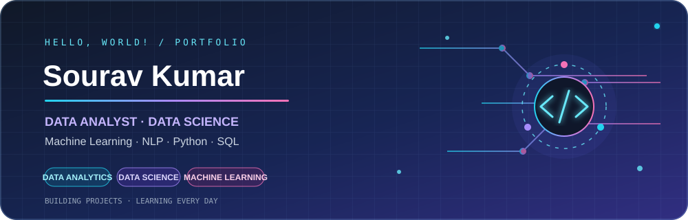

# 👋 Hi, I'm Sourav Kumar

### 📊 Data Analyst | 🧪 Aspiring Data Scientist | 🤖 Machine Learning & NLP Enthusiast

  

  <strong>Turning data into insights and building intelligent, data-driven solutions.</strong>

  

---

## 🚀 About Me

I'm passionate about exploring data, discovering patterns, and developing practical solutions using analytics, statistics, and machine learning.

- 📊 **Data Analytics:** Data cleaning, exploratory data analysis, visualization, and dashboard development.
- 🧪 **Data Science:** Statistical analysis, feature engineering, and predictive modeling.
- 🤖 **Machine Learning:** Developing models to solve real-world problems.
- 🧠 **Natural Language Processing:** Exploring skill extraction and resume-to-job matching.
- 📈 **Business Intelligence:** Building interactive dashboards with Power BI.
- 🌱 **Continuous Learning:** Improving my Python, SQL, analytics, and AI skills.

## 🛠️ Technical Skills

### 💻 Programming & Databases

  

### 📊 Data Analytics & Visualization

  
  
  
  
  

### 🧪 Data Science & Machine Learning

  
  
  
  
  
  

### 🧠 Artificial Intelligence & NLP

  
  
  

### 🌐 Web Development & Tools

  
  

---

## 🚀 Featured Projects

### 🧠 1. Automatic Skill Extraction Using NLP

An NLP-focused application designed to identify technical and soft skills in job descriptions and support resume-to-job skill matching.

**Technologies:** Python, NLP, Machine Learning, Transformers.

🔗 [Explore my repositories](https://github.com/souravwell?tab=repositories)

### 🏥 2. AI-Based Hospital Bed Occupancy Prediction

A predictive analytics project using historical hospital data, feature engineering, and machine learning to forecast next-day bed occupancy.

**Technologies:** Python, Pandas, feature engineering, Linear Regression, Power BI.

🔗 [View Hospital Bed Prediction Project](https://github.com/souravwell/AI_Hospital_Bed_Prediction_Project)

### 📈 3. Python Trading Bot

A Python-based command-line trading bot developed for Binance Futures Testnet.

**Technologies:** Python, API integration, order execution, trading automation.

🔗 [View Trading Bot Repository](https://github.com/souravwell/trading_bot)

### 🏏 4. IPL Cricket Analysis

A data analysis project focused on cricket statistics, performance indicators, and insights from IPL datasets.

**Technologies:** Python, Pandas, data visualization, exploratory data analysis.

🔗 [Browse GitHub Projects](https://github.com/souravwell?tab=repositories)

---

## 📊 GitHub Analytics

  
  

  

---

## 🎯 Current Focus

- Strengthening data science and statistical analysis skills.
- Building end-to-end machine learning projects.
- Developing NLP applications for practical use cases.
- Creating insightful Power BI dashboards.
- Improving model evaluation and feature engineering.
- Building a professional portfolio of real-world projects.

---

## 🤝 Connect With Me

  

  <i>✨ Always learning. Always building. Turning data into impact.</i>

  

